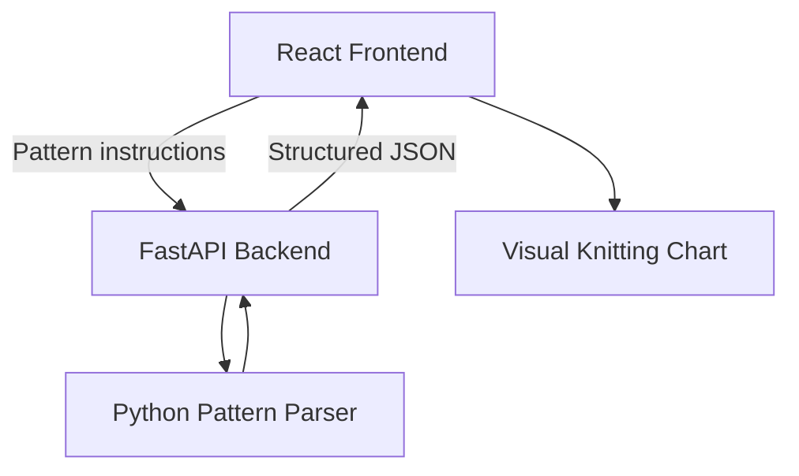

# Mosaic Knitting Converter

A web application that converts written mosaic knitting patterns into interactive visual charts.

Developed for CS 498 Senior Design at the University of Kentucky.

## Project Overview

The Mosaic Knitting Converter allows users to enter row-by-row knitting instructions and generate a visual pattern chart. Planned features include pattern validation, interactive charts, customizable colors, row tracking, pattern repeats, and PDF downloads.

**Tech Stack**
- **Frontend:** React, JavaScript, Vite, CSS
- **Backend:** Python, FastAPI
- **Version Control:** Git and GitHub

## Getting Started

### Prerequisites

Install [Git](https://git-scm.com/), [Node.js](https://nodejs.org/), and [Python 3](https://www.python.org/).

Verify installations:

```bash
git --version
node --version
npm --version
python3 --version
```

### 1. Clone the Repository

```bash
git clone https://github.com/TiramisuOwl/mosaic_knitting_converter.git
cd mosaic_knitting_converter
```

### 2. Start the Frontend

```bash
cd frontend
npm install
npm run dev
```

Open the URL shown in the terminal (typically http://localhost:5173).

### 3. Start the Backend

Open a **second terminal**, navigate to the repository's `backend` directory, and create a Python virtual environment:

```bash
cd backend
python3 -m venv .venv
```

Activate it:

**macOS/Linux**
```bash
source .venv/bin/activate
```

**Windows PowerShell**
```powershell
.\.venv\Scripts\Activate.ps1
```

Install dependencies and start the server:

```bash
python -m pip install -r requirements.txt
fastapi dev main.py
```

Verify that the backend is running at http://localhost:8000/api/health.

API documentation is available at http://localhost:8000/docs.

**For future sessions:** Open two terminals and run `npm run dev` from `frontend/` and `fastapi dev main.py` from `backend/` (activate the Python environment first). Dependencies only need to be reinstalled when they change.

## Development Workflow

All new features and fixes should be developed on a separate branch and merged into `main` through a pull request.

### 1. Create a Branch

From the repository root:

```bash
git checkout main
git pull origin main
git checkout -b feature/your-feature
```

Use descriptive branch names such as `feature/pattern-parser` or `feature/chart-grid`.

### 2. Develop and Test

Make your changes in `frontend/` or `backend/`.

For frontend changes, run from `frontend/`:

```bash
npm run lint
npm run build
```

For backend changes, test your endpoints using http://localhost:8000/docs.

For full-stack changes, run both servers and verify the functionality in your browser.

### 3. Commit and Push

From the repository root:

```bash
git status
git add .
git commit -m "Describe your changes"
git push -u origin feature/your-feature
```

### 4. Open a Pull Request

1. Open the repository's **Pull requests** tab on GitHub.
2. Create a PR from your feature branch into `main`.
3. Summarize your changes and explain how you tested them.
4. Request a teammate's review before merging.

After merging, update your local repository:

```bash
git checkout main
git pull origin main
```

**Important:** Do not commit `node_modules/`, `.venv/`, or environment files containing secrets. These are excluded through `.gitignore`.

## Architecture

The application uses React for the user interface and Python for pattern processing. FastAPI connects them using HTTP requests and JSON responses.



The parser and chart generation are under development; the current setup provides the initial frontend and backend applications.

## Contributors

Ruthie Houston, Lily Calvert, Lisa Makinen, Daniel Hasselwander, and Lainey Van Vliet.

